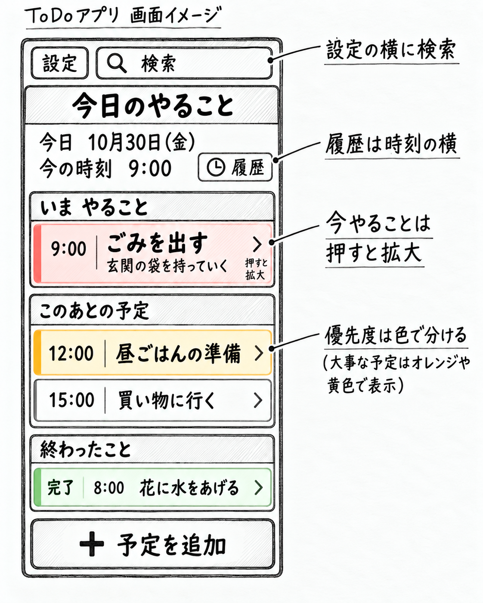
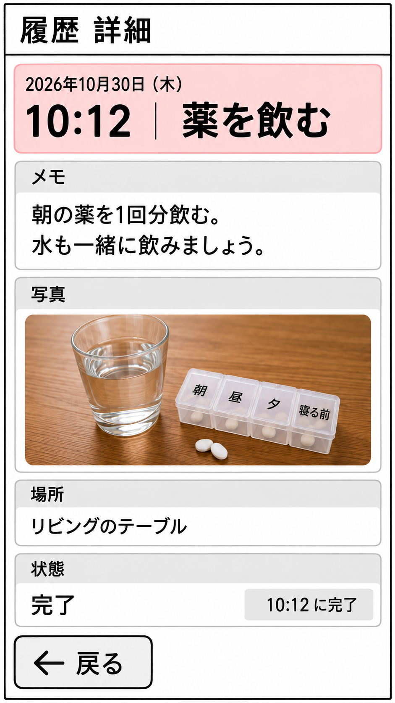
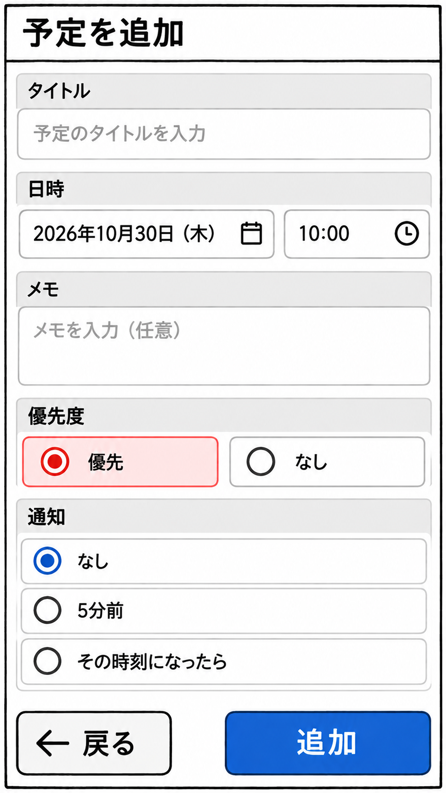
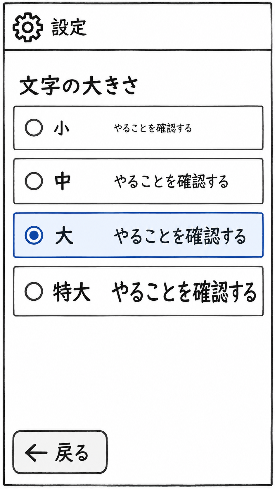
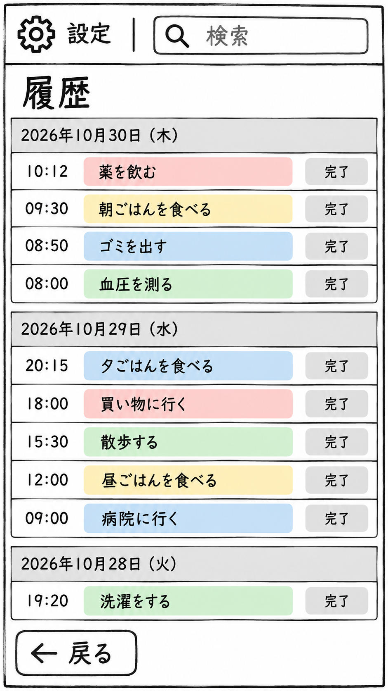
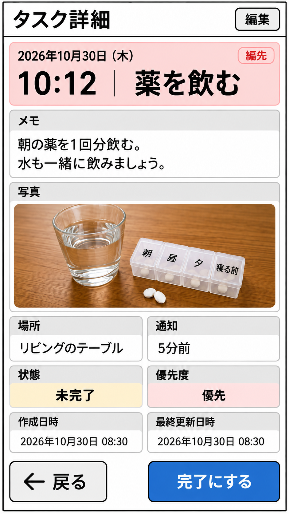
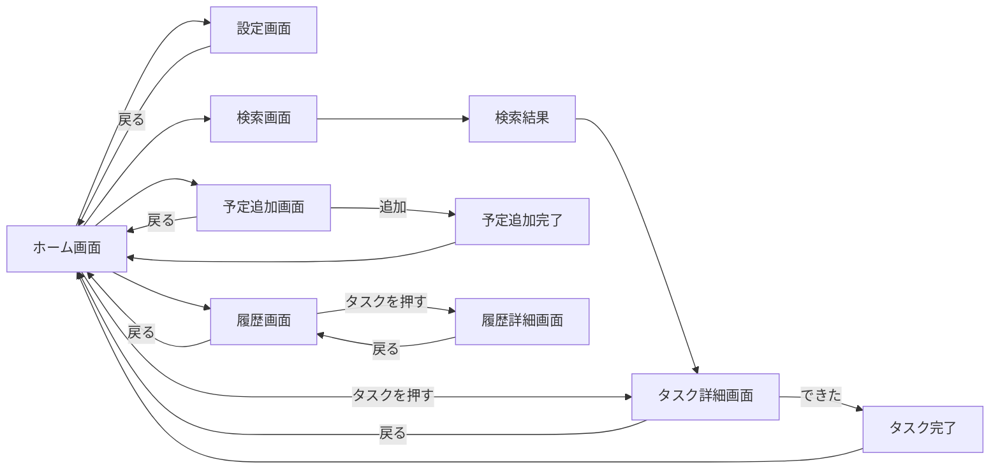
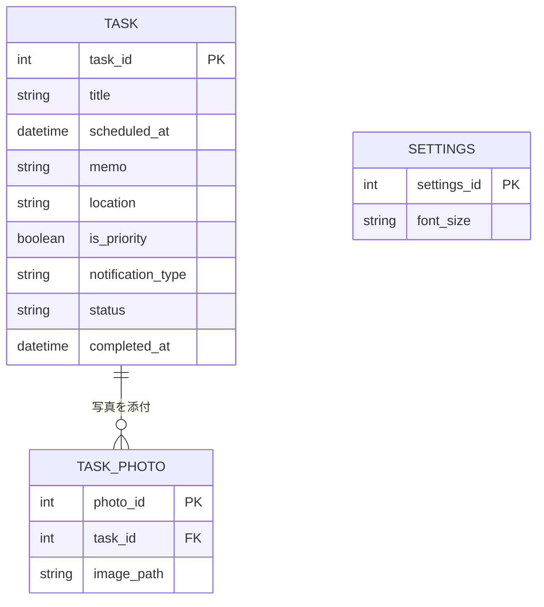

# 老人・物忘れ激しい人向けToDoアプリ

ソフトウェア開発演習 第7回 基本設計書

- チーム番号：チーム02
- メンバー：渡会亮太、新堀裕一郎

## 課題
- **選んだ課題**：老人や物忘れが激しい人がその日のやることを忘れる
- **誰の課題か**：老人、物忘れが激しい人
- **なぜこの課題を選んだか**：買い物をするときに紙に書いている人がいるが履歴を残せたら後から振り返れて効率的だと思ったから

## 0. 考えを整理する3つの問い
- **開発目的**：その時やった事を情報として残す
- **想定ユーザ**：老人、物忘れが激しい人
- **機能**：履歴に時間を表示する、優先度、検索機能、通知

## 1. ユーザーストーリー
- ストーリー1：課題の時間を忘れたときに確認したい
- ストーリー2：買い物する時に履歴を残したい

## 2. 画面イメージ（ワイヤーフレーム）

## 3. ページ遷移図

第7回時点で想定した画面と操作を示します。

## 4. データモデル（ER図）

以下は第7回の設計時点で想定したデータ構成です。写真・場所・通知は設計に含まれますが、現行のタスクには保存欄がありません。

## 5. 開発着手の許可基準に対する自己チェック
- [x] 課題の具体性：身近な実在のペインに基づいているか？
- [x] 連動性：ユーザーストーリーと画面・データモデルが破綻なく繋がっているか？
- [x] ボリュームの妥当性：第14回までに2名で作りきれる規模感か？
