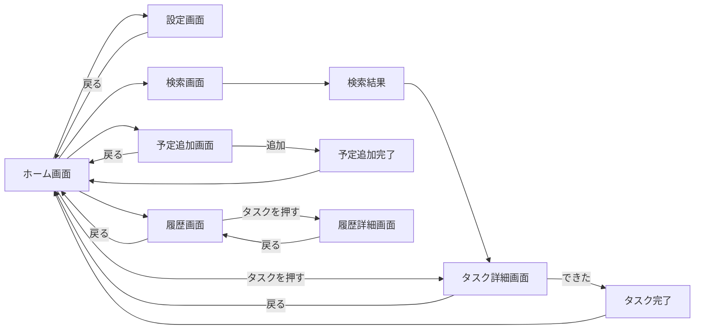
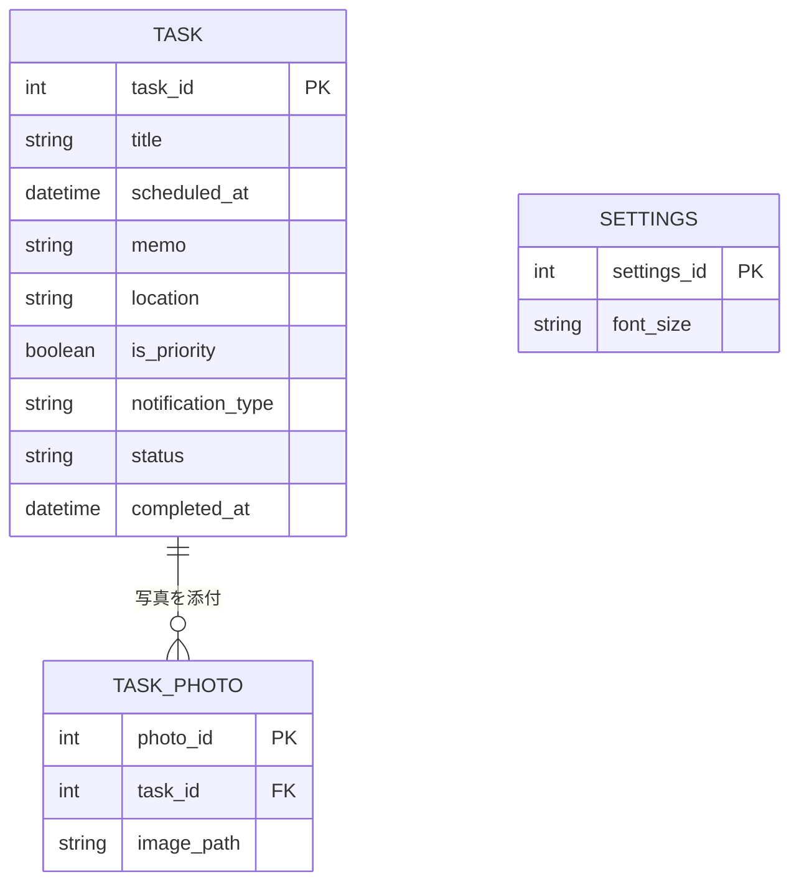

# 基本設計書：老人・物忘れ激しい人向けToDoアプリ

- チーム番号：チーム02
- メンバー：渡会亮太、新堀裕一郎

## 課題
- **選んだ課題**：老人や物忘れが激しい人がその日のやることを忘れる
- **誰の課題か**：老人、物忘れが激しい人
- **なぜこの課題を選んだか**：買い物をするときに紙に書いている人がいるが履歴を残せたら後から振り返れて効率的だと思ったから

## 0. 考えを整理する3つの問い
- **開発目的**：その時やった事を情報として残す
- **想定ユーザ**：老人、物忘れが激しい人
- **機能**：履歴に時間を表示する、優先度、検索機能、通知

## 1. ユーザーストーリー
- ストーリー1：課題の時間を忘れたときに確認したい
- ストーリー2：買い物する時に履歴を残したい

## 2. 画面イメージ（ワイヤーフレーム）
手書き・PowerPoint・Figma・Excalidrawなどで作った画面ラフを、画像として貼る。

> ここは実際に手を動かして描いた画像に差し替えてください。きれいである必要はなく、「どこに何があるか」「押したらどこへ行くか」が伝わればOKです。

## 3. ページ遷移図

## 4. データモデル（ER図）

## 5. 開発着手の許可基準に対する自己チェック
- [✔] 課題の具体性：身近な実在のペインに基づいているか？
- [✔] 連動性：ユーザーストーリーと画面・データモデルが破綻なく繋がっているか？
- [✔] ボリュームの妥当性：第14回までに2名で作りきれる規模感か？
